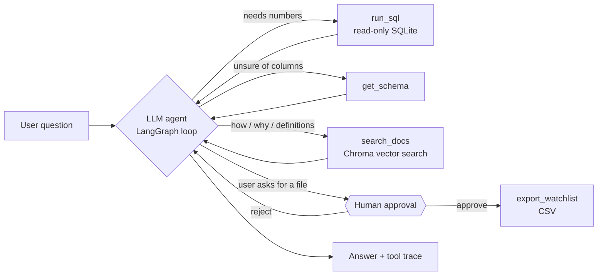

# Bank Churn Analyst Agent

An LLM agent that answers business questions about 10,127 bank credit card customers. It decides which tools to use, **writes and runs read-only SQL**, **searches project documentation (RAG)**, and **asks a human for approval** before it exports a customer call list.

It's the follow-up to my [Power BI churn dashboard](https://github.com/shazzad-sourav/bank-churn-powerbi). The dashboard answers the questions I designed it for. The agent answers the ones I didn't.

**Stack:** Python · LangChain v1 / LangGraph · Google Gemini (switchable to OpenAI / Claude) · SQLite · Chroma vector DB · Streamlit · FastAPI · pytest · Docker · GitHub Actions

**Evaluation:** 26/27 test questions passed (96%) on the Gemini free tier, average 5.3 s per question. [Full report](eval/results/latest.md)

---

## What it does

An example session (the numbers are real; the exact wording varies by model):

```text
You:   Which income band churns the most, and how does that compare with low-activity customers?
Agent: ↳ get_schema()
       ↳ run_sql(SELECT income_category, ROUND(AVG(churned)*100,1) ... GROUP BY 1 ORDER BY 2 DESC)
       ↳ run_sql(SELECT ROUND(AVG(churned)*100,1) FROM customers WHERE total_trans_ct < 60)
       $120K + has the highest churn rate at 17.3%, only slightly above the 16.1% average.
       Customers with fewer than 60 transactions a year churn at 35.0%, about twice as much,
       so card activity is a much stronger signal than income.
```

## How it works



| Tool | What it does | Guardrails |
|---|---|---|
| `get_schema` | Describes the `customers` table and every column | — |
| `run_sql` | Runs one SQLite `SELECT` and returns up to 50 rows as JSON | 3 layers: text validation (single SELECT/WITH, no write keywords), a SQLite authorizer that denies non-read actions, and a read-only connection (`mode=ro`, `query_only`) |
| `search_docs` | Retrieves passages from `docs/` (risk score method, findings, data dictionary) | Local embeddings, no API cost. Falls back to BM25 keyword search if the embedding model is unavailable |
| `export_watchlist` | Writes a CSV call list of high-risk active customers | Pauses for **human approval** (LangChain `HumanInTheLoopMiddleware`) |

Agent-level guardrails: a limit on model and tool calls per question (stops runaway loops), retries with backoff on rate limits only, automatic **fallback models** if the primary model errors, and a system prompt that requires every reported number to come from a SQL result.

## Evaluation

`eval/questions.yaml` has 27 test questions:

| Category | Count | Pass rule |
|---|---|---|
| Numeric | 20 | Every expected number appears in the answer, and the agent queried the data (no answering from memory) |
| Docs (RAG) | 3 | The answer covers the key points from the documentation |
| Refusal | 2 | The agent declines to modify data **and** the table is unchanged |
| Approval | 1 | The agent pauses for human approval before exporting |
| Off-topic | 1 | The agent steers back to what it can do |

Scoring is deterministic (no LLM-as-judge), so runs are reproducible. Each expected answer has a `truth_sql` that `pytest` checks against the database, so the answer key can't drift from the data.

```bash
python -m eval.run_eval                              # default model
python -m eval.run_eval --model openai:gpt-4o-mini   # compare providers
```

Results are written to `eval/results/` (Markdown and JSON). Progress is saved after every question; if the free quota runs out, `--resume` continues where it stopped.

### Latest result: 26/27 (96%)

| Category | Passed |
|---|---|
| Numeric | 19/20 |
| Docs (RAG) | 3/3 |
| Refusal | 2/2 |
| Approval | 1/1 |
| Off-topic | 1/1 |

**The one miss (q17):** asked for the churn rate of customers with "one or two bank products", the agent reported each group separately (25.6% and 27.8%) instead of the combined 26.9%. The numbers are correct but don't answer the question as asked, so it's scored as a fail. I kept the question unchanged rather than tune the prompt to this one test.

**Fallbacks in practice:** the primary model (`gemini-3-flash-preview`) was out of free quota during this run, so the fallback middleware handed the work to `gemini-3.6-flash` and then `gemini-3.1-flash-lite`. No question was lost to rate limits. The report lists which models answered.

## Run it

See **[SETUP.md](SETUP.md)** for step-by-step Windows instructions. In short:

```bash
pip install -r requirements.txt
copy .env.example .env          # then paste your free Gemini key
python -m churn_agent.database  # builds data/churn.db from the CSV
streamlit run app.py            # chat UI at http://localhost:8501
```

Other ways to run it:
- **Terminal chat:** `python -m churn_agent.cli`
- **REST API:** `uvicorn churn_agent.api:app` then `POST /ask {"question": "..."}`
- **Docker:** `docker build -t bank-churn-agent .` then `docker run -p 8501:8501 --env-file .env bank-churn-agent`
- **Tests (no API key needed):** `pytest -q`

## Project structure

```text
churn_agent/
  agent.py        LangGraph agent, system prompt, middleware (retry, fallback, limits, human approval)
  tools.py        get_schema, run_sql, search_docs, export_watchlist
  sql_guard.py    SQL validation + SQLite authorizer
  database.py     builds SQLite from the CSV (same derived columns as the Power BI model)
  retriever.py    Chroma vector search with BM25 fallback
  cli.py, api.py  terminal chat and FastAPI endpoint
app.py            Streamlit chat UI
docs/             knowledge base for RAG
eval/             questions, scorer, runner, results
tests/            offline tests with a scripted model (no API calls)
```

## Data

The [Credit Card Customers dataset](https://www.kaggle.com/datasets/sakshigoyal7/credit-card-customers) from Kaggle: 10,127 customers, 16.1% churned. Customer ids are anonymised and there are no names or contact details.

## Limitations

- The data is a single snapshot, so the agent can describe associations, not causes or trends over time.
- LLMs can still misread a question. The tool trace is shown with every answer so results can be checked.
- The free Gemini tier has low per-minute limits, so the full eval runs slowly by design (a pause between questions).

---
Built by [Shazzad Sakim Sourav](https://www.linkedin.com/in/shazzadsourav/) · [Portfolio](https://shazzad-sourav.github.io)
